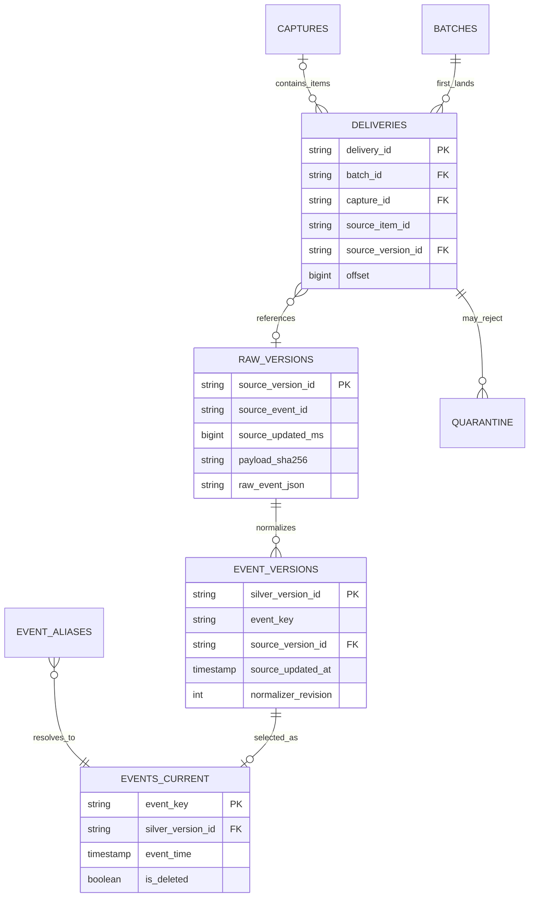
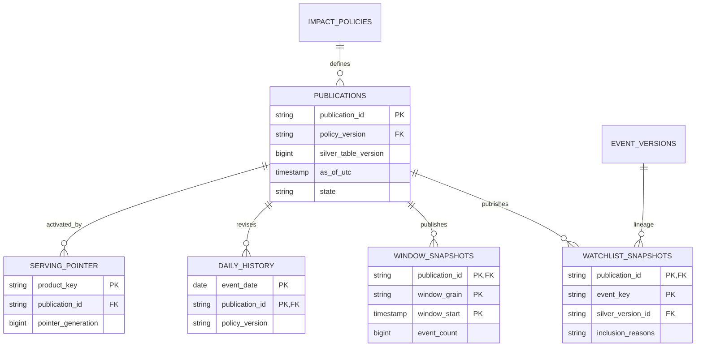
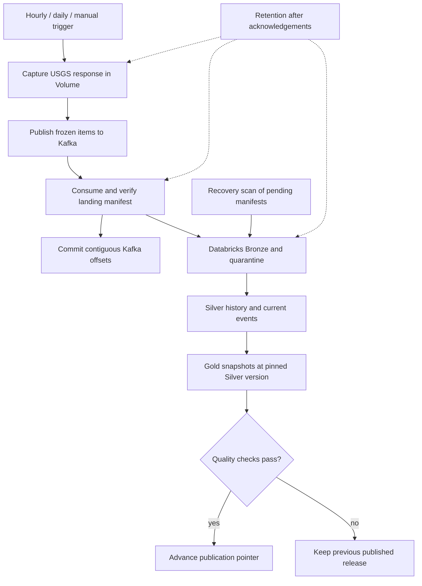

# Earthquake Impact Watchlist — project memory and implementation plan

Status: baseline revision 3, 15 October 2026. Sprint 1–2 code is implemented and offline-validated; cloud deployment and acceptance remain pending. The database and pipeline specification below is the implementation contract for all ten sprints; it refines the initial decisions where explicitly noted.

## Goal and constraints

### Required coding and delivery conventions (user instruction, 15 October 2026)

- Read current primary documentation relevant to each implementation before coding, and record the consulted documentation and applicable behavior in the sprint notes. Verify errors against those sources instead of relying on recalled API signatures.
- Begin every code file with a concise description of the file's purpose and main responsibilities. Python modules, classes and functions have clear docstrings; SQL/workflow/config files use an appropriate header comment or descriptive metadata.
- Add essential inline comments explaining non-obvious decisions, ordering, failure handling and invariants. Keep comments concise and useful; avoid narrating obvious statements.
- Deliver repository-relative new files and complete replacement files for every sprint, with a manifest identifying NEW versus REPLACE. Preserve existing unrelated files. If the current repository contents have not been read, do not claim a merge or compatibility with unseen local edits.
- Give exact repository update steps, configuration names, Databricks steps, run commands and expected success/failure evidence directly in the chat as well as in the package. Do not rely only on an attached guide.
- Separate implementation/test completion from actual deployment and cloud acceptance. Report what was exercised, what passed and what remains unverified. Do not mark a sprint live-validated without the required cloud evidence.
- At sprint completion, record new design decisions, changed files, verification evidence and remaining gates in this project memory. Subsequent sprints read this baseline and the preceding sprint handoff before changing code.

Build an automated, cloud-only data engineering portfolio project that regularly collects USGS earthquake data, keeps a reliable history of source revisions, and publishes a defensible watchlist of potentially impactful events. It is not an emergency warning service or a claim of confirmed damage.

- Free services: GitHub Actions as scheduled, ephemeral producer/consumer; Aiven Free Apache Kafka as temporary buffer; Databricks Free Edition managed Volume and Delta tables for durable data and processing; USGS as public source.
- No persistent data on the user's computer or GitHub runner. No always-on service and no third-party monitoring service. Logs must not contain payloads or credentials.
- Airflow is deferred: GitHub Actions and Databricks Jobs already cover the initial scheduling and processing dependencies.
- Direct Databricks-to-Aiven connectivity has not been proven; use the tested GitHub-runner bridge.
- Keep a manual dispatch/backfill path. Serialise ingestion and reconciliation against the same tables. Treat free-tier limits as a design constraint and verify use after deployment.

## What is already validated

The manual compatibility workflow succeeded end to end: USGS feed read; Aiven Kafka produce and consume; verified Databricks Volume Files API upload; Databricks Job invocation; Spark/Delta MERGE. This proves connectivity, not production recovery, retention, scheduling, schema handling, or cross-system exactly-once behavior. The smoke-test topic and table remain separate from production data.

## Accepted initial design decisions

| Area | Decision | Validation needed |
| --- | --- | --- |
| Source and scope | Poll USGS M2.5+ past-day GeoJSON hourly, and reconcile M2.5+ past-30-days plus significant past-30-days daily. Treat coverage as bounded by these feeds. A targeted, bounded USGS catalog backfill handles outages beyond the feed horizon. | Actual daily source counts, size and quota usage. |
| Timing | Run hourly at minute 17 UTC. Daily reconciliation at a separate off-hour minute. Display last successful publish time. Use UTC throughout. GitHub scheduled events are best-effort, so missed-run recovery is required. | Actual latency and compute quota over a week. |
| Product | Display past-30-day event candidates. Reasons include USGS `sig > 600`, PAGER yellow/orange/red, magnitude >= 6.0, ShakeMap maximum MMI >= VI, or tsunami flag. Label PAGER as estimated impact; other triggers as potential impact. Link source and show revision and freshness. A tsunami flag alone is not a warning. | Review historical false positives/negatives; tune thresholds in versioned policy. |
| Event time | `properties.time` is origin/event time, `properties.updated` is source revision time, and ingestion time is recorded separately. Hourly/daily Gold windows use event time in UTC. Late revisions recompute affected windows over a 30-day horizon; older changes require controlled backfill. | Test late, out-of-order and changed-source cases. |
| Identity | Use USGS `id` as event ID and Kafka key. Track `(event_id, updated_ms, payload_sha256)` as the observed-version identity. Deduplicate within each source batch before Delta MERGE. | Duplicate replay and same-timestamp/different-payload cases. |
| Revision/delete | Silver has one current row per event, selected by version ordering; an older replay cannot replace a newer version. Keep history in Bronze. Never infer deletion from absence in a bounded feed. Query previously displayed event IDs and USGS deleted-event support; mark withdrawn records rather than silently erasing history. | Historical amendment, magnitude demotion, and explicit deletion fixtures. |
| Kafka | One production topic initially with one partition, stable consumer group, manual offset commits, producer acknowledgements and retry. Kafka is a temporary buffer with at most 72-hour retention on the free tier. | Offset restart, expired message and outage recovery. |
| Durable handoff | The runner uploads immutable batch files under a unique Volume batch ID, verifies checksums, writes a manifest last, then commits Kafka offsets. A Databricks recovery job scans all complete manifests not yet acknowledged in Bronze. Partial batches are ignored and later cleaned. | Failure before/after manifest, lost ACK, repeated upload. |
| Idempotency | Use deterministic interval/batch IDs for retries, job launch idempotency tokens, distinct manifest keys, and idempotent Delta MERGEs. At-least-once delivery and effectively one current business record are the targets; do not claim a distributed exactly-once transaction. | Retry/replay fault-injection gates. |
| Bronze | Retain source event versions, raw JSON, source/feed, event/updated/ingestion timestamps, hash, batch/manifest provenance, validation flags. Quarantine malformed records separately with reason and source reference. | Schema drift, nulls, invalid coordinates, reconciliation counts. |
| Silver | Parse and type fields, normalize units and UTC times, maintain the latest source state plus revision history/withdrawal state. Separate missing optional impact products from invalid input. | One current row/event and deterministic revision selection. |
| Gold | Materialize watchlist candidates with explainable reasons and estimated-vs-potential labels; hourly/daily counts and 7-day trends; track policy version and upstream batch lineage. Reader sees only last complete published batch. | Ranking examples, freshness and cross-table consistency. |
| Atomicity | Each Delta write/MERGE is atomic on its table. Across Kafka, Volume and multiple Delta tables, use persisted batch states (`FETCHED`, `LANDED`, `BRONZE_COMMITTED`, `SILVER_COMMITTED`, `PUBLISHED`), recovery and a final Gold publication pointer; no global transaction is assumed. | Fail between every state transition. |
| API handling | Bounded timeouts, exponential backoff with jitter; honor HTTP Retry-After for 429; retry transient 5xx/network failures; surface 4xx/auth/config errors. Validate feed count and structure. Distinguish genuine zero events from bad/truncated responses. | Simulated 429/5xx, truncated JSON, empty feed. |
| Monitoring | Use Databricks operations tables and GitHub/Databricks job status, without an external monitoring service. Track last fetch/publish, source freshness, unprocessed manifest age, offsets, duplicates, quarantine count, source/target count reconciliation, latency and failures. Show a stale-data banner. | Operational thresholds and failure visibility. |
| Access | GitHub Secrets for Aiven credentials/CA and Databricks token; variables for nonsecret identifiers. Minimize token permissions, rotate when needed, never print secrets or full payloads. | Permissions and secret redaction checks. |

## Initial retention and recovery policy

These durations are proposed, not yet measured against free-tier usage:

| Asset | Initial rule |
| --- | --- |
| Kafka | Free-tier maximum 72 hours; not a durable archive. |
| Incomplete Volume landing | Keep 7 days for diagnosis, then remove after proving no valid manifest and no active run. |
| Processed Volume landing | Keep 30 days; remove only after Bronze checksum/count acknowledgment and a successful replay window. |
| Bronze source versions | 90 days. This is the full raw replay horizon. |
| Quarantine | 30 days unless an unresolved incident needs longer. |
| Silver current events | 1 year. |
| Gold event/trend history | Up to 2 years, adjusted if Free Edition quota forces a smaller horizon. |
| Ops metadata | 1 year without raw payloads or secrets. |

For ordinary table rollback, record batch ID and Delta table versions at publication. Keep at least seven days of Delta deleted-file retention; available time travel requires both retained log and data files. Point consumers to the previous good Gold publication before any repair. Reprocess retained Bronze for semantic corrections; use `RESTORE` only while its referenced data remains available. A daily published Gold snapshot supports comparison, and selected historical backfills may require refetching USGS. Delta history is not a long-term backup. Retention jobs must test affected rows/files and maintain a deletion audit. Do not turn off Delta's retention safety checks.

## Ten implementation sprints

Each sprint ends with its acceptance gate before the next begins. Keep a short decision log and essential file comments/docstrings. Use dedicated development namespace/table names before any production promotion.

### Sprint 1 — Contract, repo and baselines

- Define feeds, product audience, exact initial threshold policy, event/updated/processing timestamps, data contracts, table names, batch states and expected cost envelope.
- Set repository structure, typed config, secret names, CI lint/type checks and manual workflow. Preserve the working smoke test separately.
- Gate: documented contract, reproducible setup, secret-free logs, and a manual preflight that checks configuration without writing data.

### Sprint 2 — Scheduled source collection and API resilience

- Implement hourly USGS feed fetch with UTC interval ID, timeouts, bounded retry/jitter, Retry-After handling, structure/count checks, and metadata-only run record.
- Add daily 30-day reconciliation and manual bounded historical backfill inputs. Design for delayed/dropped GitHub schedules.
- Gate: injected 429/5xx, malformed JSON, valid empty response, rerun and missed-interval cases are distinguished correctly; no local persistent payload.

### Sprint 3 — Kafka publish and durable cloud handoff

- Create production topic and stable consumer group. Publish event-keyed records; consume in bounded batches; upload unique Volume paths, verify hashes and manifest-last completion; commit offsets after complete landing.
- Serialize workflow runs. A recovery scan lists complete manifests not yet processed, independent of current Kafka offsets.
- Gate: kill/retry at produce, upload, manifest and commit points; no event lost or incorrectly marked processed. Validate Aiven Free capacity.

### Sprint 4 — Bronze and batch ledger

- Create Delta Bronze versions, quarantine and `ops.batches`. Parse manifested files; preserve raw JSON and source lineage; deduplicate by ID, source update and hash; acknowledge manifest only after an atomic Bronze write.
- Gate: replay same batch twice leaves Bronze unchanged; distinct revisions survive; malformed rows are quarantined; source, landing and accepted/rejected counts reconcile.

### Sprint 5 — Silver current state and revisions

- Build typed event model, optional-field handling, revision comparison, current row MERGE, history/withdrawal state and targeted checks for tracked display events.
- Gate: out-of-order revisions, conflicting payloads, magnitude demotion and explicit deletion yield exactly one correct current row and an explainable history.

### Sprint 6 — Impact policy and Gold publication

- Version the watchlist rules, annotate each qualifying event with inclusion reasons and source quality; materialize UTC hourly/daily aggregates and affected-window corrections.
- Publish by a final batch pointer only after all required outputs succeed; expose freshness and source links.
- Gate: reviewed historical fixtures show correct labels; retry does not duplicate rows; a deliberately failed downstream task does not expose partial Gold data.

### Sprint 7 — Reconciliation, late data and backfill

- Compare daily 30-day source scans with Silver, reopen changed event-time windows, and implement bounded older-history backfill through the USGS catalog API. Record coverage limits and gaps.
- Gate: simulate missed hourly runs, a two-day outage, late PAGER updates and a backfill; resulting current rows and windows match a clean replay.

### Sprint 8 — Retention, snapshots and rollback

- Add lifecycle policies above, daily Gold publication snapshots, Delta-version lineage and safe rollback/runbook. Require Bronze acknowledgment before landing cleanup.
- Gate: dry-run shows exact deletion targets; rollback to a known good publication works; replay within 90-day Bronze horizon restores derived data; no unsafe VACUUM interval.

### Sprint 9 — Fault tolerance, quality and quota validation

- Persist failure classification, bounded retries, ops metrics, data freshness checks, stale-data banner and recovery runbook. Exercise Databricks/Aiven/USGS outages and concurrent-run prevention.
- Gate: failure injection shows no silent loss or premature publish; one week of measured runtime/storage stays within free-tier capacity, with schedule adjusted if needed.

### Sprint 10 — Public demonstration and portfolio handoff

- Publish an inspectable Databricks SQL query or modest dashboard for current candidates and trends; document architecture, tradeoffs, data caveats, operational runbook, reproducible demos and evidence from successful runs.
- Gate: a reviewer can inspect one event from USGS through Kafka landing, Bronze, Silver and Gold; can observe a replay without duplication and a corrected/withdrawn record without a stale public claim.

## Decision log and caveats

- The scope is initially USGS-defined and globally sampled through selected feeds. This is not a complete global earthquake catalog.
- A 30-day feed reconciliation can detect revisions while the event remains within the feed window; tracked IDs and bounded catalog backfills cover selected older changes. No guarantee is made about every historical source revision that occurred between polling runs.
- USGS `sig`, PAGER and ShakeMap describe different evidence. Missing PAGER is not evidence of no impact. Product wording must preserve this distinction.
- Hourly scheduling, 90-day Bronze and two-year Gold are assumptions to revisit after observing Databricks Free Edition fair-use quota and Aiven storage behavior.
- Direct Spark Kafka consumption, 24/7 service reliability and cross-service exactly-once delivery have not been validated by the smoke test.

## Primary documentation checked (October 2026)

- USGS GeoJSON feeds: https://earthquake.usgs.gov/earthquakes/feed/v1.0/geojson.php
- USGS catalog query and deleted events: https://earthquake.usgs.gov/fdsnws/event/1/
- USGS significance definition: https://earthquake.usgs.gov/earthquakes/statistics/significant.php
- USGS PAGER: https://earthquake.usgs.gov/data/pager/background.php
- Aiven Free Kafka: https://aiven.io/docs/products/kafka/free-tier/kafka-free-tier
- Databricks Free Edition limits: https://docs.databricks.com/aws/en/getting-started/free-edition-limitations
- Databricks Delta atomicity: https://docs.databricks.com/aws/en/lakehouse/acid
- Databricks Delta retention: https://docs.databricks.com/aws/en/delta/vacuum
- GitHub scheduled workflow caveats: https://docs.github.com/en/actions/reference/workflows-and-actions/events-that-trigger-workflows

# Database and pipeline specification — revision 2

## A. Refinements to the initial baseline

1. **Freeze each source response before Kafka publication.** The GitHub runner uploads the response and a verified capture manifest to the Databricks managed Volume. That immutable capture acts as an outbox: a retry sends the captured response again instead of fetching a possibly changed feed. Failure before that capture is sealed is recovered by another source fetch; the project cannot guarantee preservation of a response never durably captured, or of source revisions that occur between polls.
2. **Separate delivery from source state.** One source version may appear in many feed snapshots and at many Kafka offsets. Store one raw version and a separate, smaller delivery row for each Kafka offset. Retrying a consumer does not create a new delivery; republishing creates a new delivery with the same source item/version identity.
3. **Preserve the accepted event ID rule with an alias map.** Retain the exact USGS `id`. Use a stable internal `event_key` to associate preferred IDs and aliases only when USGS explicitly links them. Never merge earthquakes using similar coordinates or origin times. Ambiguous alias collisions block the affected identity update and are quarantined.
4. **Publication is a consistent data release.** All Gold rows carry `publication_id`; a single pointer switches consumers only after validation. Read a single publication ID once for a dashboard refresh. Two independent queries that each reread the pointer could otherwise straddle a release.
5. **Detailed history is not unlimited.** Bronze raw versions remain for 90 days; normalized Silver history and current data for one year; hourly Gold snapshots for seven days; one designated daily Gold snapshot plus published daily aggregate revisions for two years. Keep compact publication and lineage ledger rows two years to interpret that Gold history. Full raw replay beyond 90 days requires a source backfill and may not reconstruct past intermediate revisions.
6. **No early public scheduling.** Sprint 2 adds and validates scheduler configuration, but production scheduling is enabled only after the handoff and Bronze safety gates in Sprints 3–4. Before then, use manual dispatch and fixtures so no unconsumed production backlog is created.

## B. Namespace and physical storage

Use Unity Catalog managed Delta tables. This is a lakehouse database design, not PostgreSQL. Development catalog: `earthquake_dev`; production catalog: `earthquake_prod`. Both contain schemas `ref`, `ops`, `bronze`, `silver`, `gold`. The tested `earthquake_compat.default` objects remain the disposable smoke-test namespace.

Managed Volume: `/Volumes/<catalog>/ops/landing/`. Its logical layout is:

- `captures/<collection_id>/<capture_id>/response.json` and `ready.json` — frozen USGS response, checksum, count, source URL, fetch/generation time and request parameters.
- `dispatch/<capture_id>/<dispatch_generation>/<chunk_id>.json` — immutable receipt written after the entire deterministic source chunk has Kafka broker acknowledgements. Missing receipt permits replay of that chunk. A recovery generation can republish an acknowledged but never accounted chunk after broker expiry without overwriting an earlier receipt.
- `batches/<stream_generation>/<partition>/<batch_id>/part-00000.jsonl` and `manifest.json` — consumed Kafka records and their broker metadata; manifest written and verified last.
- `receipts/bronze/<batch_id>.json` and `receipts/captures/<capture_id>.json` — Databricks acknowledgements after row/count reconciliation. These files help an ephemeral runner recover without querying mutable Delta tables through an untested API route.
- `diagnostics/` — sanitized failure records to import into Ops when compute resumes; GitHub logs remain the fallback if even Volume access is unavailable.

Volume directories are data files, not Delta tables. Never place external manifests inside a managed Delta table's physical directory. Never rely on a file rename or multi-file upload being atomic: a verified, immutable final manifest is the logical visibility boundary. On an existing path, compare bytes/checksums; identical is success and different content is a conflict, never an overwrite.

Start all Delta tables **unpartitioned**. Batch small inputs; do not partition by event ID or create tiny date/hour partitions. Use ordinary STRING identifiers, BIGINT epoch milliseconds, UTC TIMESTAMP, DATE, DOUBLE numerical values and ARRAY/STRUCT fields where shown. Add clustering only after measured query growth.

Primary/foreign keys below describe logical grain and lineage. Databricks PK/FK declarations do not enforce uniqueness or referential integrity. Enforce NOT NULL/CHECK where supported, and enforce keys using serialized writes, deduplicated MERGE inputs and quality checks. Do not mark key constraints RELY until validated. Different retention horizons make older provenance references archival links rather than guaranteed live joins.

## C. Identity contract

Hashes use SHA-256 over versioned, unambiguous serialized tuples (not plain string concatenation). JSON canonicalization rules are pinned by `contract_version`. Capture hash is over original response bytes. The semantic event payload hash uses an explicit common summary projection of source event/impact fields and geometry, excluding runner metadata, response wrappers, detail-only product arrays, URLs and alias/preferred-ID metadata. Summary and detail responses describing the same source state must hash identically. Raw JSON and its independent raw-feature checksum preserve structural evidence; unknown fields trigger schema observation without automatically inventing a new semantic revision.

| Identifier | Grain / rule |
| --- | --- |
| `run_id` | One actual orchestration attempt; retain GitHub run ID and attempt separately. |
| `collection_id` | Hash of environment, source/feed, run kind, fixed UTC request interval, request filters and contract version. Same logical collection on retry. |
| `capture_id` | Hash of `collection_id` and response checksum. Once a complete capture is selected for a collection, retry from it. An intentional refreshed fetch uses a new collection generation. |
| `source_item_id` | Hash of `capture_id` and ordinal within the sealed response. Allows full capture accounting even when events duplicate across feeds. |
| `source_version_id` | Hash of source system, exact source event ID, source updated milliseconds and semantic payload hash. Independent of capture, runner and Kafka offsets. |
| `stream_generation` | Configuration identity for one Aiven topic lifetime. Change it if the topic is recreated so reused offset numbers cannot collide. |
| `delivery_id` | Hash of stream generation, topic, partition and offset. Stable under consumer replay. |
| `batch_id` | Hash of stream generation, partition, contiguous offset range and landed-content digest. Different batch boundaries can overlap during recovery; delivery IDs still deduplicate. |
| `event_key` | Stable internal ID assigned to the first unambiguous USGS identity; aliases point to it. Source `id` remains recorded. |
| `silver_version_id` | Hash of event key, source version ID and integer normalizer revision. |
| `publication_id` | Hash of processing generation, pinned Silver table version, policy version and fixed `as_of_utc`. Failed outputs retry under the same ID. |

## D. Table inventory and column dictionary

Names below omit `<catalog>.` for readability. Unless nullable is stated, key and control fields are required. JSON hashes are STRING hex values. Timestamps are UTC. `*_count` is BIGINT. IDs are STRING. These are schema contracts to translate into DDL during the sprints; no tables are created by this design document.

### Reference tables

**1. `ref.sources` — one row per source/feed configuration revision**

- Logical PK: `(source_id, source_revision INT)`.
- Fields: `provider`, `feed_key`, `base_url`, `request_parameters MAP<STRING,STRING>`, `collection_mode`, `lookback_days INT`, `contract_version`, `enabled BOOLEAN`, `created_at TIMESTAMP`.
- Write: immutable configuration seed from Git, no secrets. Capture rows pin their source revision.

**2. `ref.impact_policies` — one immutable eligibility policy revision**

- PK: `policy_version`.
- Fields: `rules_json STRING`, `description`, `code_commit`, `created_at TIMESTAMP`.
- Rules v1: significant >600 OR PAGER yellow/orange/red OR magnitude >=6 OR MMI >=6 OR tsunami_flag=1. Evaluate each independently with null-safe comparisons. Keep matching reason codes in Gold. PAGER estimates and tsunami flags are labeled explicitly; no statement of confirmed damage follows from these rules.

### Operations tables

**3. `ops.runs` — one orchestration attempt**

- PK: `run_id`.
- Fields: `run_kind` (HOURLY/RECONCILE/BACKFILL/RECOVERY/RETENTION/REPLAY), `github_run_id`, `github_attempt INT`, `databricks_run_id` nullable, `window_start/end TIMESTAMP`, `started_at/finished_at TIMESTAMP`, `status`, `code_commit`, `contract_version`, `error_class` nullable.
- A failed pre-compute attempt may first exist in a Volume diagnostic or GitHub logs; import it later. The database must not pretend to have logged every failure while it was unavailable.

**4. `ops.captures` — one sealed USGS response**

- PK: `capture_id`; links to source revision and first `run_id`.
- Fields: `collection_id`, `source_id`, `source_revision INT`, `run_id`, `response_uri`, `manifest_uri`, `response_sha256`, `fetched_at`, `source_generated_at` nullable, `expected_item_count`, `accounted_item_count`, `dispatch_chunk_count`, `state` (CAPTURED/PUBLISH_ACKED/ACCOUNTED), `accounted_at` nullable.
- Authoritative source for initial recovery is the sealed Volume manifest. The Delta ledger is reconstructed from it if necessary. A capture is ACCOUNTED only when every distinct source item has a valid Bronze delivery or a durable rejection.

**5. `ops.batches` — one complete consumed-offset landing batch**

- PK: `batch_id`.
- Fields: `run_id`, `stream_generation`, `topic`, `partition INT`, `offset_first/last BIGINT`, `manifest_uri`, `manifest_sha256`, `row_count`, `accepted_delivery_count`, `quarantined_delivery_count`, `distinct_source_version_count`, `bronze_insert_count`, `landed_at`, `bronze_committed_at` nullable, `silver_committed_at` nullable, `data_stage`, `last_attempt_status`.
- Data stage moves forward: LANDED -> BRONZE_COMMITTED -> SILVER_COMMITTED. Failures belong to stage attempts and do not erase a successful earlier stage. Publication metadata lists the processed batch IDs; no assumption that one input batch equals one publication.

**6. `ops.stage_attempts` — one attempted stage or external request**

- PK: `attempt_id` = hash(run, task key, scope, attempt number).
- Fields: `run_id`, `scope_type`, `scope_id`, `stage_name`, `attempt_number INT`, `status`, `started_at/finished_at`, `retryable BOOLEAN`, `http_status INT` nullable, `error_code` nullable, `sanitized_message` nullable, `metrics MAP<STRING,STRING>`.
- Stages include FETCH, CAPTURE, PUBLISH, LAND, BRONZE, SILVER, GOLD, PUBLISH_POINTER, RETENTION. Store one HTTP request attempt here as a scoped stage, rather than a new telemetry table.

**7. `ops.check_results` — one rule evaluation for one scope/run**

- PK: `check_id`.
- Fields: `run_id`, `scope_type`, `scope_id`, `rule_id`, `rule_version`, `severity`, `status` (PASS/WARN/FAIL), `observed_value DOUBLE` nullable, `expected_value STRING` nullable, `evaluated_at`, `resolved_at` nullable, `details_json` nullable.
- Includes key uniqueness, count accounting, freshness, missing interval/offset gaps, alias conflict and incomplete capture checks. Unresolved checks are the initial incident list; no external monitoring service.

**8. `ops.publications` — one Gold release, including empty releases**

- PK: `publication_id`.
- Fields: `run_id`, `policy_version`, `normalizer_revision INT`, `silver_table_version BIGINT`, `input_batch_ids ARRAY<STRING>`, `as_of_utc`, `source_checked_through TIMESTAMP`, `coverage_start/end`, `expected_watchlist_rows`, `expected_window_rows`, `state` (BUILDING/READY), `created_at`, `ready_at` nullable, `is_daily_snapshot BOOLEAN`, `output_table_versions MAP<STRING,BIGINT>`.
- Small input lineage array is acceptable at this project's bounded batch count. Split it into a bridge table only when needed. `source_checked_through` derives from verified source checks and pending capture state, not the maximum observed earthquake timestamp.

**9. `ops.serving_pointer` — one row per public product**

- PK: `product_key` (initial value `earthquake_watchlist`).
- Fields: `publication_id`, `previous_publication_id` nullable, `pointer_generation BIGINT`, `updated_at`, `run_id`.
- A conditional single-table MERGE advances the pointer only after a READY release. Serialize normal publication, rollback and retention. A retry for the already-active publication is a no-op; an older run cannot overwrite a newer generation.

**10. `ops.retention_log` — one retention plan or action**

- PK: `action_id`.
- Fields: `run_id`, `asset_name`, `cutoff_at`, `selection_predicate`, `candidate_count`, `deleted_count`, `dry_run BOOLEAN`, `status`, `started_at/finished_at`, `protected_publication_ids ARRAY<STRING>`, `error_code` nullable.
- Check eligibility twice if deletion is delayed. Never delete the active publication, retained daily snapshots, unfinished/unaccounted captures or files still required by an active attempt.

### Bronze tables

**11. `bronze.event_versions` — one distinct observed raw event version**

- PK: `source_version_id`.
- Fields: `source_system` (`usgs`), `source_event_id`, `source_updated_ms BIGINT`, `event_time_ms BIGINT` nullable, `payload_sha256`, `raw_feature_sha256`, `raw_event_json STRING`, `contract_version`, `first_capture_id`, `first_delivery_id`, `first_ingested_at`.
- Insert-only MERGE; later identical deliveries do not overwrite first-seen provenance. Unknown source fields remain in JSON. Retention uses first ingestion time, with a maximum age of 90 days subject to active-processing holds.

**12. `bronze.deliveries` — one broker message, including rejected messages**

- PK: `delivery_id`.
- Fields: `batch_id` (first successful landing), `stream_generation`, `topic`, `partition INT`, `offset BIGINT`, `kafka_timestamp` nullable, `capture_id` nullable for a malformed envelope, `source_item_id` nullable, `source_version_id` nullable on rejection, `message_sha256`, `received_at`, `disposition` (ACCEPTED/QUARANTINED).
- The manifest stores raw message bytes safely; malformed non-UTF8 bytes are base64 encoded for quarantine. If a recovered batch overlaps an earlier batch, verify all manifest delivery IDs exist and match checksums rather than relying only on this first-batch FK.

**13. `bronze.quarantine` — one rejection per delivery/stage/contract revision**

- PK: `quarantine_id`.
- Fields: `delivery_id`, `batch_id`, `stage_name`, `contract_or_normalizer_revision`, `error_codes ARRAY<STRING>`, `raw_value_b64` nullable, `raw_reference_uri` nullable, `rejected_at`, `resolution_status`, `resolved_at` nullable, `replay_run_id` nullable.
- One row can contain several reasons, so counts reconcile per rejected message rather than per failed rule. Before deleting referenced landing files, keep enough raw evidence here to diagnose/replay within its 30-day horizon. A rejected delivery never disappears just because it was skipped by parsing.

### Silver tables

**14. `silver.event_aliases` — one source identifier to one stable internal event**

- PK: `(source_system, alias_event_id)`.
- Fields: `event_key`, `is_preferred BOOLEAN`, `evidence_source_version_id`, `first_seen_at`, `last_confirmed_at`.
- Read the USGS `ids` list as evidence. More than one existing event key in an incoming alias set is a conflict requiring an explicit resolution, not an automatic fuzzy merge.

**15. `silver.event_versions` — normalized source state history**

- PK: `silver_version_id`.
- Fields: `event_key`, `source_version_id`, `source_event_id`, `normalizer_revision INT`, `source_updated_at`, `event_time`, `event_date DATE`, `longitude/latitude/depth_km DOUBLE` nullable on withdrawal, `magnitude DOUBLE` nullable, `magnitude_type` nullable, `place` nullable, `pager_alert` nullable, `mmi/cdi DOUBLE` nullable, `felt_count BIGINT` nullable, `significance BIGINT` nullable, `tsunami_flag INT` nullable, `review_status` nullable, `event_type` nullable, `source_url`, `is_deleted BOOLEAN`, `selection_status` (ACCEPTED/CONFLICT), `normalized_at`.
- Normalize only validated records. Retain all valid observed versions, including older ones. This is source-version history, not a claim of valid-time SCD2 intervals: late arrivals can change source chronology. Bitemporal/SCD2 interval views may be added later from this evidence.

**16. `silver.events_current` — latest accepted source state per event**

- PK: `event_key`.
- Fields: `silver_version_id`, `source_version_id`, `source_event_id`, the typed event/impact fields above, `source_updated_at`, `first_observed_at`, `last_confirmed_at`, `is_deleted`, `has_unresolved_conflict BOOLEAN`, `normalizer_revision INT`.
- Choose latest source update first. For the same source timestamp and same semantic source payload, a newer normalizer revision may replace the transformed result during an explicit migration. Different payloads at the same source timestamp require an authoritative event-ID refetch/resolution; do not select the lexically largest hash or latest network arrival. Hold the last accepted current state and expose the quality issue.
- Use NOT NULL only for identity and required ordering/control fields. Missing magnitude/PAGER/MMI is not zero. Negative earthquake depths can be valid; coordinate and numeric validation follows USGS ranges rather than rejecting every negative depth.
- Derive `first_observed_at` as the minimum durable source capture fetch time and `last_confirmed_at` as its maximum for this event. Replaying the same capture cannot advance freshness using a new processing timestamp. Freshness in public views also checks unaccounted captures and source-check coverage.
- No `WHEN NOT MATCHED BY SOURCE DELETE` against a partial feed. Explicit withdrawal becomes a newer typed tombstone with evidence, not a physical deletion from current state.
- Tombstone ordering must use authoritative source revision evidence. If the deletion response lacks a source revision timestamp, record the check as unresolved and require explicit resolution; never fabricate a USGS updated time from local ingestion time.

### Gold tables and public views

**17. `gold.watchlist_snapshots` — one eligible current event per release**

- PK: `(publication_id, event_key)`.
- Fields: `silver_version_id`, `policy_version`, `event_time`, `source_updated_at`, copied display fields, `inclusion_reasons ARRAY<STRING>`, `impact_label` (ESTIMATED_IMPACT/POTENTIAL_IMPACT), `quality_flags ARRAY<STRING>`, `rank_priority INT`, `source_url`, `as_of_utc`.
- Snapshot covers `[as_of_utc - 30 days, as_of_utc)` by event time, excludes withdrawn records and includes only true policy matches. A revised event can disappear on the next release when it no longer qualifies. Store facts from the pinned Silver version; do not join this snapshot to mutable current-state fields when serving it.
- Rank PAGER red/orange/yellow first, then remaining reasons, then significance descending, magnitude descending and event key as deterministic tie-break. Label ranking as watchlist priority rather than a scientific risk score.

**18. `gold.window_snapshots` — global hourly/daily windows for one release**

- PK: `(publication_id, window_grain, window_start)`.
- Fields: `window_end`, `event_count`, `watchlist_count`, `max_magnitude DOUBLE` nullable, `pager_yellow_count`, `pager_orange_count`, `pager_red_count`, `as_of_utc`, `is_partial BOOLEAN`.
- Use half-open UTC windows `[start,end)`. Counts use one nondeleted latest event state from the same pinned Silver snapshot. Include zero-count windows. Rebuild the last 30 days as a bounded unit initially; at this small volume this is easier to verify than incremental +/- arithmetic. Origin-time revisions can affect both the old and new window. Hour/day buckets intersecting the 30-day lower bound or as-of time are marked partial.
- Aggregation is GLOBAL only initially. Do not parse `place` text into countries or invent population exposure. Geographic polygons/population enrichment requires its own sourced design decision.

**19. `gold.daily_history` — revisions to published daily aggregates**

- PK: `(event_date, publication_id)`.
- Fields: `policy_version`, daily count/maximum/PAGER fields, `as_of_utc`, `coverage_status`, `is_partial BOOLEAN`.
- Write affected dates including changed-to-zero dates. Append a revision after reconciliation/backfill; serve the latest READY publication revision per date. These historical comparisons are a separate product and need not all have the current watchlist's publication ID. Policy changes remain labeled; do not compare counts across policies without disclosing the change.

Public SQL views: `gold.v_watchlist_current`, `gold.v_windows_current`, `gold.v_daily_history`, `ops.v_pipeline_health`. Watchlist/windows views filter by the pointer, but a dashboard must resolve the pointer once and pass that publication ID to all queries in one refresh for consistent multi-query results. Surface the publication timestamp, source-check freshness and partial coverage.

## E. ER diagrams

Rendered vector diagrams and editable Graphviz sources accompany this document in `earthquake-design-pack.zip`. Relationships below describe logical keys; there is no cross-system foreign-key enforcement.

### E1. Source and event data

### E2. Publication and serving

## F. Pipeline definitions and ownership

### P1. Source capture and Kafka publication — GitHub runner

1. Acquire the environment's workflow concurrency slot; compute collection intervals from explicit UTC inputs, never the runner's local timezone.
2. Drain any older Kafka backlog first within the run budget. Discover unfinished source captures via ready manifests and receipts.
3. Fetch configured USGS feeds with timeouts and a bounded request budget. Suggested initial retry: five attempts, exponential delay starting at two seconds, maximum 60 seconds plus jitter; honor a longer Retry-After by recording deferred work and ending instead of waiting indefinitely.
4. Freeze the exact response in the Volume, verify its checksum, parse/count it and write the capture ready manifest last. HTTP 204 is a successful empty response when the endpoint supports it; an unexpected blank/truncated body is not silently an empty feed. Persist an empty capture as evidence of a successful check.
5. Split that immutable capture into deterministic chunks. For every item send a versioned Kafka envelope: source/capture/item IDs, exact feature JSON, source timestamps, payload hash, contract version. Key by exact USGS source ID; Silver later resolves aliases.
6. Wait for broker acknowledgement with `acks=all`. Write one dispatch receipt per fully acknowledged chunk. Missing/uncertain receipt causes replay of that chunk, which may create duplicate Kafka deliveries but not duplicate source versions.
7. Do not fetch a new snapshot to complete an interrupted frozen capture. A fresh source check is a new collection generation. For large backfills, split origin-time windows so each capture and per-run budget is bounded; USGS catalog requests are not a stable CDC log.
8. Producer acknowledgements do not guarantee later consumption. If a capture remains unaccounted and its messages expire or the topic is lost/recreated, create a recorded dispatch recovery generation and resend its immutable chunks. Keep source item IDs unchanged; apply the new stream generation if the topic was recreated. Old dispatch receipts alone must never suppress this recovery.

### P2. Kafka-to-Volume durable handoff — GitHub runner

1. Use one stable consumer group per environment and stream generation. Disable auto commit. Consume only contiguous offset ranges for a partition.
2. Suggested initial file target: 1,000 messages or 2 MiB, whichever comes first; reject/defer an oversized single item explicitly. Suggested per-run publish budget: 5,000 messages and 20-minute wall time, then record remaining backlog for the next run. Tune after measurement.
3. Upload message metadata and bytes to an immutable batch path. Verify file bytes/checksums and count; write/verify the final manifest.
4. Commit exactly `last_contiguous_offset + 1`. If commit or its acknowledgement fails, replay is permitted. Never commit past a hole or failed landing file. Include poison messages as quarantinable bytes so they do not block a partition forever.
5. Trigger the Databricks processing job. Job launch idempotency tokens are stable for retries of that launch request. A failed existing run needs repair or a new recorded recovery generation; reusing a token does not magically rerun a failed job.
6. On an out-of-range consumer offset, record the gap before any explicit offset reset. Check for already-landed manifests, then republish missing source capture items through a recovery dispatch. Do not silently use automatic earliest/latest reset as evidence that no data was lost.

### P3. Bronze ingestion and recovery — Databricks Job

1. List complete manifests with no valid Bronze receipt. Reconcile this list with the Ops ledger; never rely on Kafka offsets alone to find unprocessed cloud files.
2. Verify manifest/file checksum, contract and delivery identities. Split valid source versions and rejected messages; deduplicate source versions and deliveries within the batch.
3. Idempotently MERGE raw versions, deliveries and quarantine. Each table write is separately atomic. If one write fails, the batch remains unacknowledged; rerun all idempotently.
4. Prove every manifest delivery exists with matching checksum/disposition; unique source item accounting equals the capture's expected items when complete. Bronze insert count may be lower than valid-delivery count because versions repeat.
5. Advance `ops.batches` to BRONZE_COMMITTED and write the verified receipt. A receipt must never precede all required writes/checks. Repair a missing receipt by rechecking the tables.

### P4. Silver normalization and identity — Databricks Job

1. Process Bronze batches not yet Silver-acknowledged under one writer. Select valid source features; derive aliases only from explicit source identity evidence.
2. Write normalized event-version history and quarantine identity/typing conflicts. A late but valid older revision remains in history.
3. Select a single accepted latest record per event before current-state MERGE. Reject a current-state regression in source timestamp. Handle authoritative same-time conflicts as specified above.
4. Process explicit deletion evidence; retain a withdrawal record and its evidence. Missing from feeds, HTTP 404 alone or moving below a magnitude threshold is not a confirmed deletion.
5. Complete checks and acknowledge the batch's Silver stage only after both history/current writes are consistent. Batch replay repairs partial writes.

### P5. Gold build and atomic publication — Databricks Job

1. Pin `silver.events_current` to a concrete Delta table version, policy version and fixed UTC as-of. Record a BUILDING publication.
2. Build deterministic watchlist and 30-day hour/day window snapshots from that version. Use the same version and policy across outputs. First-seen/processing-time metrics are separate from origin-time windows.
3. Append relevant daily aggregate history revisions. Validate uniqueness, counts, known policy codes, references and absence of withdrawn candidates. A zero-watchlist release is valid if source checks succeeded.
4. Mark the publication READY after outputs and output versions are recorded. Switch the single product pointer atomically with a generation check. Do not expose BUILDING output through public views.
5. If the pointer ACK is lost, read it; already active is success. If the build fails, retain the previous pointer and mark the failed attempt. A READY release need not become active if superseded.

### P6. Reconciliation, event checks and historical backfill

- Daily fetch both 30-day feeds through P1–P5. Repeated versions are harmless. Record coverage per source check and expected-item accounting, not just the newest event observed.
- Check previously displayed recent event IDs directly, with a small capped request budget and oldest-check-first ordering. This catches a magnitude demotion or withdrawal that removes it from a selected feed.
- Query explicit deleted-event support during bounded catalog reconciliation. A missing response is unresolved until corroborated; do not delete by anti-join with a feed.
- Backfill historical origin-time slices with explicit start/end and catalog filters; split any query that risks the API result limit. Route every result through the same capture/Kafka/Bronze/Silver path.
- Recompute affected historical daily aggregates, including both dates when origin time changes. A backfill can publish a new current release, but cannot falsify freshness of today's source check. Old corrections can change archive rows without entering the 30-day watchlist.

### P7. Retention and rollback

- Daily plan/dry-run retention first, then apply controlled deletions and audit them. Initial live rollout requires a reviewed dry-run gate. Never clean unresolved source outbox captures because their clock has passed a nominal age.
- Source captures: keep 30 days **after ACCOUNTED** and at least through all active retries. Kafka landing: keep 30 days after verified Bronze acknowledgment; keep incomplete/unmanifested files seven days unless active. Bronze versions/deliveries: 90 days with active-job holds. Quarantine: 30 days. Silver versions/current: one-year observation/event scope with live-incident holds.
- Hourly Gold releases: seven days. One designated daily READY release: two years, plus the active and previous known-good release regardless of age. `gold.daily_history`: two years by event date. Retain `ref.impact_policies`, `ops.publications` and compact capture/batch lineage referenced by retained Gold for two years; detailed attempt logs/checks/retention audit: one year.
- Maintain two-year daily series from Gold history once source Silver ages out; never rebuild those old dates as zero simply because one-year Silver retention removed their input. Mark no-longer-rebuildable history and require source backfill for correction.
- Keep Delta deleted-file retention at least seven days and transaction logs long enough for promised time travel; do not disable safety checks. Published snapshots are ordinary retained rows and survive Delta time-travel expiry until their explicit row retention is applied.
- Roll back the pointer to a retained READY publication for immediate serving recovery, pause new promotion, fix transformations, then replay Bronze or backfill. `RESTORE` on one table does not roll back other tables. Keep the exact processing and policy version in the recovery attempt. Confirm an old release's source freshness visibly after rollback.

## G. Orchestration DAG and states

Only the GitHub runner contacts USGS and Kafka; Databricks compute consumes manifests/tables from its own storage. All three launch modes route through the same serialized processing job with max concurrent runs = 1. A daily Databricks recovery-only launch may run that same job to find landed work if GitHub's job trigger failed; it must not create a second Silver writer. The runner can collect to a bounded backlog while compute is unavailable, but stops/defer publication when configured backlog limits are exceeded.

State machines:

- Capture: CAPTURED -> PUBLISH_ACKED -> ACCOUNTED. Missing ACK can cause replay; accounting proves downstream receipt. API success without accounted source items is not an ingestion success.
- Landing batch: LANDED -> BRONZE_COMMITTED -> SILVER_COMMITTED. `last_attempt_status=FAILED` can coexist with an earlier successful data stage.
- Publication: BUILDING -> READY -> optionally activated by pointer. A pointer rollback creates an audited activation event; it does not mutate snapshot facts.

## H. Safety and correctness invariants for acceptance tests

1. Every sealed source capture has either all items accounted or an explicit pending/failure condition. Do not mark it complete from producer ACKs alone.
2. Every consumed Kafka offset below a committed offset has a verified complete landing manifest for the contiguous range.
3. Every Bronze-acknowledged manifest row has one accepted or quarantined delivery ID with matching checksum; rejected deliveries are not dropped.
4. Source version and delivery keys remain unique after repeat ingestion and overlapping batch recovery.
5. Silver current has one accepted state/event, never regresses source update time and never conflates nearby distinct events.
6. Gold candidates and windows share a pinned Silver version, policy and as-of time; publication only follows completed checks, including valid empty output.
7. Consumer retries, lost upload/commit/job ACKs and partial table writes converge without duplicate business facts. No end-to-end distributed transaction is claimed.
8. Retention preserves unfinished work, retained publications and the stated replay horizon. Historical series are not erased because upstream raw retention expired.

## I. Sprint-to-object map

| Sprint | Database/pipeline deliverables |
| --- | --- |
| 1 | Catalog/schema names, source and policy contracts, ID formulas, manifest/envelope specifications, ERDs and repository config; `ref.sources`, `ref.impact_policies` DDL design. |
| 2 | P1 fetch/capture boundary, immutable source manifests, request retries; `ops.runs`, `ops.captures`, `ops.stage_attempts`. Scheduler tested with fixtures/manual runs until Sprints 3–4 pass. |
| 3 | P1 publish/P2 landing, stable group and stream generation, dispatch and landing manifests, offset/recovery receipts; `ops.batches`. |
| 4 | P3 Bronze, delivery accounting and quarantine; `bronze.event_versions`, `bronze.deliveries`, `bronze.quarantine`, first `ops.check_results`; enable production schedule only after its gate. |
| 5 | P4 typed history/current, aliases, explicit deletion and same-time conflict handling; all three Silver tables. |
| 6 | P5 pinned publication, all three Gold tables, `ops.publications`, `ops.serving_pointer`, public views and policy validation. |
| 7 | P6 daily reconciliation, bounded event checks/backfill and correction of old/new event-time windows; coverage checks in Ops. |
| 8 | P7 lifecycle implementation, `ops.retention_log`, daily snapshot selection and rollback drill; retention gates enabled after dry-run review. |
| 9 | Full fault/replay scenarios, quota observation, pipeline-health view, backlog controls and stale data signal; tune bounded configuration from measurements. |
| 10 | Databricks SQL/dashboard delivery, publication-consistent querying, reviewer traceability and reproducible demonstration. |

## J. Current design status

This is a reviewable schema/pipeline specification. Sprint 1–2 source, setup-notebook and ledger-sync code has been implemented and offline-validated. No new cloud resources, Delta tables, jobs, schedules or retention actions have been deployed by the assistant. Run the delivered setup and acceptance steps in the user's workspace before marking these sprints live-validated. Later physical DDL and pipelines remain assigned to their sprints. Expected design-change triggers: quota measurements, incompatible Free Edition features, source schema changes, and empirical watchlist quality.

Additional primary documentation checked for this revision:

- Informational PK/FK constraints: https://docs.databricks.com/aws/en/tables/constraints
- Delta MERGE source deduplication: https://docs.databricks.com/aws/en/delta/merge
- Small table partition guidance: https://docs.databricks.com/aws/en/tables/partitions
- USGS ComCat: https://earthquake.usgs.gov/data/comcat/

## K. Sprint 1–2 implementation record

Delivered 15 October 2026 as `earthquake-sprints-01-02.zip`, with repository-relative files in `repo-update/`, a NEW/REPLACE manifest and the complete handoff. The current remote repository was not fetched. Delivery assumes the known, previously successful smoke-test baseline, preserves its `src/probe.py`, `requirements.txt`, `README.md` and compatibility workflow, and does not claim compatibility with unseen user edits.

### Implemented

- `src/quake_pipeline/`: typed source/runtime settings, UTC collection windows and deterministic IDs, strict source envelope validation, standard-library bounded HTTP with Retry-After handling, confined Files API uploads with overwrite=false/readback hashes, immutable capture and selected-manifest recovery, safe run reports, and idempotent Databricks ledger Job launch/polling.
- `.github/workflows/source-capture.yml`: manual preflight, read-only feed validation or cloud capture; capture then automatically triggers the configured ledger Job. Development concurrency only, no production schedule. `.github/workflows/quality.yml`: offline tests and documentation/syntax gate without credentials.
- `databricks/sprints_01_02_setup.py`: creates the development catalog, all five layer schemas, managed `ops.landing` Volume and the initial five tables: `ref.sources`, `ref.impact_policies`, `ops.runs`, `ops.captures`, `ops.stage_attempts`. Seeds three feeds and policy impact-v1.
- `databricks/sprint_02_sync_capture_ledger.py`: explicit-schema metadata import, independent raw-file checksum verification and idempotent Ops MERGEs; no Bronze/Silver/Gold business data yet.
- Config policy, data contracts, coding standards, updated project memory, exact setup instructions, tests and convention gate.

### Evidence and remaining gates

30 offline tests passed, including rate limiting, transient errors, invalid certificates/auth, malformed/empty/count-mismatched feed, ID equivalence, request/body limits, lost PUT/job ACK, interrupted selection, corruption/conflict, frozen source reuse and paginated listing. Syntax and explanatory docstrings passed for all 13 owned Python files. The new runtime needs no pip dependencies. Tests use an in-memory fake cloud; notebooks were syntax-checked and have NOT been executed against the user's Databricks Spark environment.

Cloud acceptance still requires: run setup notebook; configure the new capture-ledger Job with max concurrency 1; set `EQ_VOLUME_ROOT`, `EQ_COLLECTION_GENERATION` and `EQ_CAPTURE_LEDGER_JOB_ID`; run preflight; capture hourly and reconcile feeds; repeat the same fixed interval and verify the same capture ID/original fetch time; verify zero duplicate `ops.captures` keys. Expected downstream state is CAPTURED and accounted count zero until Sprint 3–4. An old uncaptured interval requires future catalog backfill, not a current-feed impersonation.

### Refinements from implementation

- `EQ_VOLUME_ROOT` deliberately differs from compatibility `DATABRICKS_VOLUME_ROOT`; dev capture uses `/Volumes/earthquake_dev/ops/landing`. Existing compatibility settings remain valid.
- `collections/<collection_id>/selected.json` freezes the chosen source capture. If that write is interrupted, recover the earliest complete ready capture using all Files API pagination tokens. Reuse verifies actual source bytes again.
- Request telemetry is stored in one terminal `runs/<run_id>/report.json`; a diagnostic upload that cannot succeed is reported in Actions logs. Transport response contents/credential headers are not logged.
- Databricks ledger import is a separate successful Job requirement after durable source capture. On failure, correct/retry with the captured interval instead of replacing its bytes. Job idempotency prevents duplicate launch for one request token, not automatic rerun of a failed Job.
- Start scheduling only after Sprint 3–4 handoff/recovery safety gates. Source capture is manually dispatched for acceptance now.
- Consulted primary documentation and exact installation commands are recorded in `docs/SPRINT_01_02_HANDOFF.md` inside the delivery and repository update.
